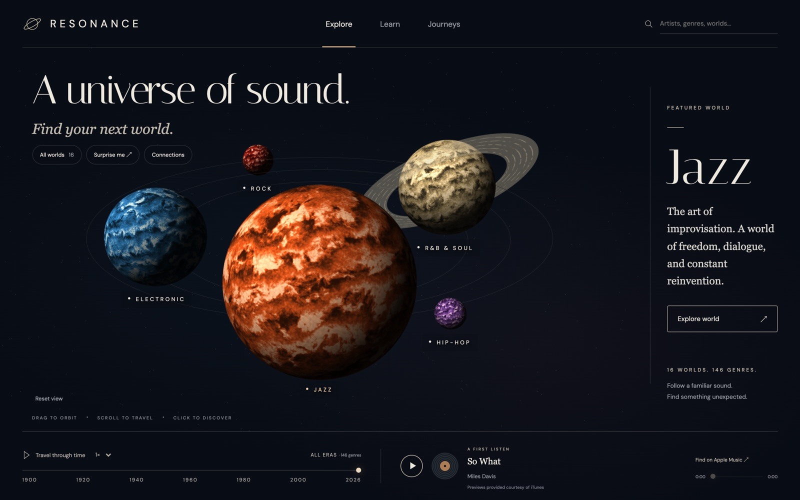
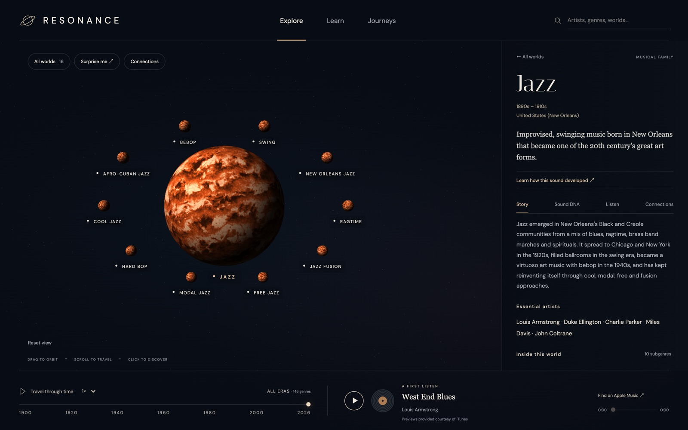
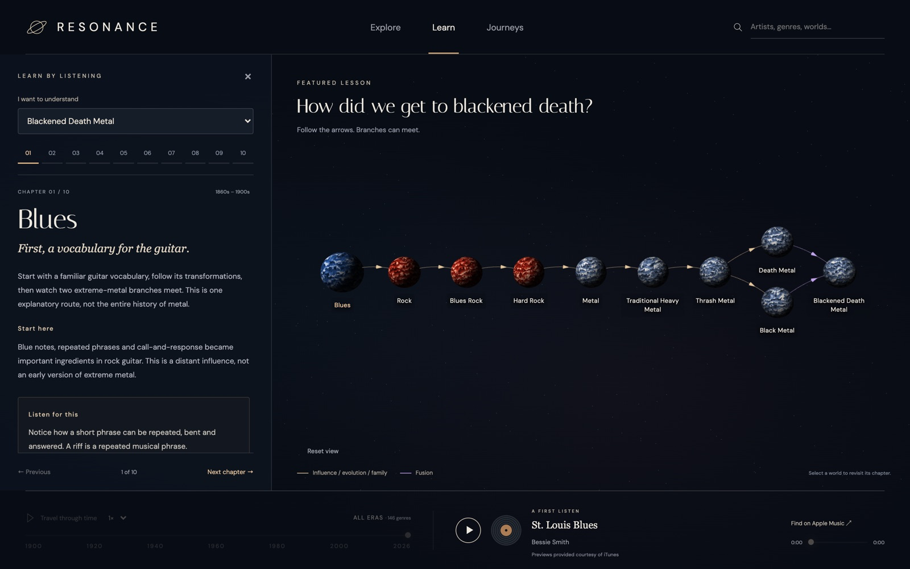
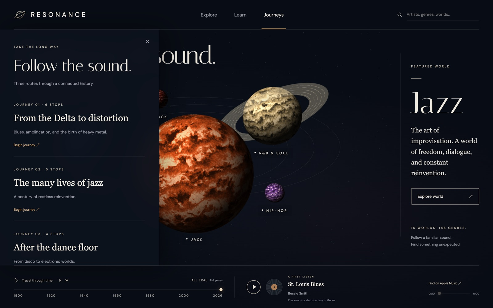
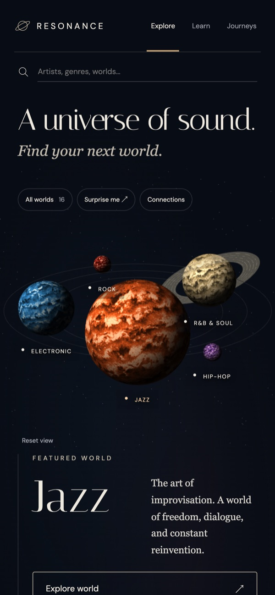

# Resonance — A universe of sound

An interactive 3D atlas of music genres, their history and how they influence each other.



## Screenshots

| Inside a world | Learning mode |
| --- | --- |
|  |  |
| **Journeys** | **Mobile** |
|  |  |

## Run

Requires pnpm 9.12.3.

```sh
pnpm install --frozen-lockfile
pnpm dev
```

## Features

- Explore 146 genres across 16 families in a 3D universe.
- Read each genre's story, sound and connections.
- Listen to track previews from Apple Music.
- Follow curated journeys and find influence paths between genres.
- Filter genres by year with the timeline.
- Learn how a sound developed with Learning mode.

## Scope

- Genre data and dates are approximate. It is not a complete history of world music.
- Previews need a network connection and depend on Apple Music availability.
- Without WebGL, the genre list and text content still work.
